<p align="center">
  <picture>
    <source media="(prefers-color-scheme: dark)" srcset="docs/assets/hero-dark.svg">
    
  </picture>
</p>

# Migrate from Klue: export your cards and battlecards in one command

calven-migrate-from-klue is a free, open-source command-line tool that exports the cards and battlecards your Klue account can see to Markdown and JSON files on your own machine. It signs in with your own Klue account through Klue's official MCP server and sends nothing to Calven. The files work in any tool that takes uploads.

> This is an independent open-source project by Calven AI, LLC. It is not affiliated with, endorsed by or sponsored by Klue Labs Inc. Klue is a trademark of Klue Labs Inc., used here only to identify the service this tool works with. The tool runs on your machine, signs in with your own Klue account through Klue's official MCP server, and writes files only to your computer. Nothing is sent to Calven. Use it in line with your agreement with Klue: content that Klue wrote or sourced for you (for example news and review excerpts) is licensed to you for internal use during your subscription, not owned by you. Provided under the MIT License, without warranty; check the export against your Klue workspace before relying on it.

## How do I export my cards and battlecards from Klue?

You need Node.js 20 or later and a Klue login. Run:

```sh
npx github:calven-ai/calven-migrate-from-klue
```

1. A browser tab opens. Sign in to Klue and approve read access.
2. The tool pages through every card and battlecard your Klue role can see. A Klue admin sees the most.
3. It writes the files to `./klue-export-<date>` and revokes the access it was given.

Expect a few minutes for a large workspace. If something fails, nothing is sent anywhere; fix the cause and run it again with `--force`.

No browser on the machine? Add `--no-browser` and open the printed link anywhere. Have a Klue personal access token? Set `KLUE_TOKEN` (it stays out of your shell history) or pass `--token`.

Writing into a folder that holds an earlier export? Add `--force` to replace it. The tool only ever replaces a folder it exported to.

## What does the export contain?

```
klue-export-2026-10-12/
  manifest.json      counts, tools used, origin counts, warnings
  cards.json         every card
  battlecards.json   every battlecard
  markdown/
    index.md         table of contents by competitor
    cards/<competitor>/<card>.md
    battlecards/<competitor>/<battlecard>.md
  raw/               Klue's response to every page request
  tools.json         the tools Klue's server offered
```

Each Markdown file starts with front matter (title, competitor, section, tags, author, dates, origin) followed by the card body. The JSON keeps the original HTML and the full Klue item, and `raw/` keeps the result of every page request with the arguments sent, so nothing the mapping misses is lost. Field definitions are in [docs/schema.md](docs/schema.md).

## Which content is yours to take?

Klue's [terms](https://klue.com/terms) say the customer owns its Customer Data and has 90 days after a termination notice to extract it. Content Klue wrote or sourced, such as news and review excerpts, is licensed for internal use while the subscription runs. Every exported item carries an `origin`, read from the fields Klue returns, to help you tell them apart:

| origin | how it is set |
| --- | --- |
| `customer` | a named author and no field marking it as sourced |
| `klue_or_third_party` | a field marks it as sourced (news, reviews), or the author is Klue |
| `unknown` | no author and no marker |

It is a first pass, not a ruling: a card your team wrote around a pasted news excerpt still counts as `customer`. Check `customer` and `unknown` items before you reuse them, and delete Klue's content when your Klue contract ends.

## How do I move the export into another tool?

The files are plain Markdown and JSON, so any tool that takes uploads can import them. Keep a copy outside both tools. The rest of a migration (notice dates, rebuilding the cards, moving the team) is covered in Calven's guide to [migrating off Klue](https://calven.ai/resources/competitive-intelligence/how-to-migrate-off-klue-or-crayon?utm_source=github&utm_medium=oss&utm_campaign=migrate-from-klue).

**Moving to Calven?** Upload the files your team wrote and leave out anything Klue wrote or sourced. Calven researches each competitor from scratch and works your cards into its own. [Start at calven.ai](https://calven.ai/?utm_source=github&utm_medium=oss&utm_campaign=migrate-from-klue).

## Can Claude run the export for me?

Yes. The [migrate-from-klue skill](skills/migrate-from-klue/SKILL.md) has Claude Code run this command. It runs the command rather than reading cards through a chat, so nothing is paraphrased and large workspaces do not hit context limits. If you then work with the files in an AI tool, use one that does not train on your inputs, such as Claude Team, Enterprise or the API.

## FAQ

**Is it free?** Yes. It is MIT-licensed and you need no Calven account.

**Does Calven see my data?** No. The tool talks only to Klue and writes only to your computer.

**Does it export win-loss interviews?** Not yet. It exports cards and battlecards.

**What if it stops with an error?**

| What you see | What to do |
| --- | --- |
| `needs arguments this tool does not fill in` | Run `npx github:calven-ai/calven-migrate-from-klue inspect`, find the argument in `klue-tools.json`, and pass it with `--arg name=value`. |
| `has no cards extraction tool` | Your Klue role cannot extract cards. Ask a Klue admin to run it. |
| a warning that the export may be incomplete | Compare the counts in `manifest.json` with Klue and open an issue. |
| sign-in fails | Your Klue workspace may block third-party apps. Use `--token` with a personal access token. |

`inspect` writes tool names and argument schemas only, no card content, so it is safe to attach to an issue.

## Status

Tested end to end against a simulated Klue server across four paging styles and three response shapes, and checked against Klue's live sign-in server. The first full export on a real Klue workspace is still pending. If you run it, an issue with your `manifest.json` (counts, no content) helps.

## License

[MIT](LICENSE). Report security issues as described in [SECURITY.md](SECURITY.md).
